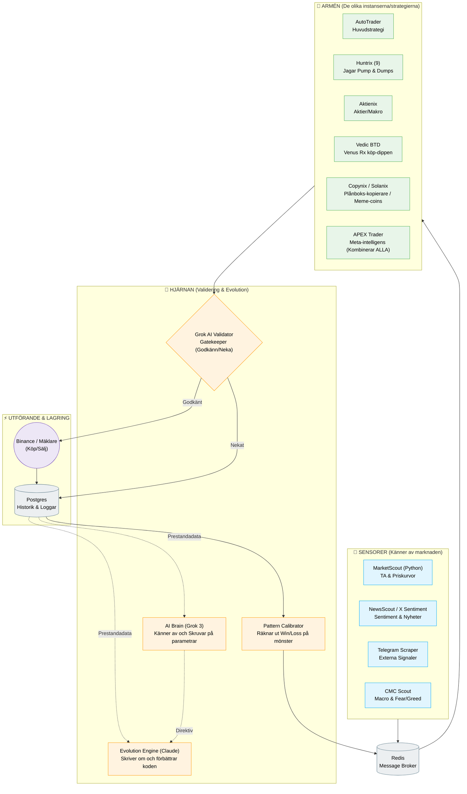
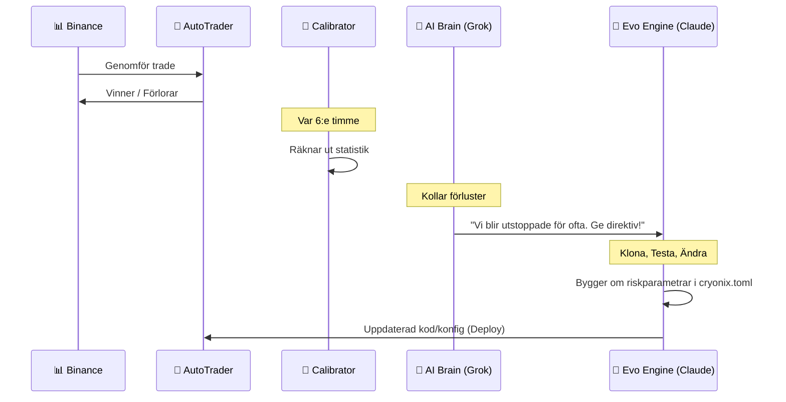

# The Agent Army — Arkitektur & Modeller

Här är en förenklad översikt över hur hela ekosystemet ("Cryonix Agent Army") hänger ihop. Projektet är byggt som en **svärm av agenter** där varje del har en specifik uppgift. Tillsammans samlar de in data, verifierar den, fattar beslut, handlar och utvärderar sig själva för att hela tiden bli bättre.

Vi kan dela in systemet i fyra logiska lager:
1. **Sensorer / Data** (Samlar information)
2. **Hjärnan / Logik** (Analyserar, godkänner och lär sig)
3. **Armén / Agenterna** (Strategi-specifika instanser som utför handlandet)
4. **Utförande / Utvärdering** (Själva köpen och utvärderingen)

---

## 1. Övergripande Arkitektur

Detta diagram visar hur data flödar från marknaden hela vägen ner till ett faktiskt köpbeslut.

---

## 2. Agent-Armén: Vem gör vad?

Istället för en enda stor kodklump som ska vara bra på allt, fungerar systemet som en armé där varje agent är en *specialist*. De senaste tillskotten och de nya konfigurationerna har gjort teamet väldigt vasst:

*   **Auto-Trader (Core):** Den stadiga arbetshästen. Följer klassisk Teknisk Analys (TA) och volym.
*   **Huntrix (tidigare Predator Hunter):** Spårhunden. Letar medvetet efter koordinerade "shills" och pump-and-dump grupper på X och Telegram för att surfa medvetet på vågen, och hoppa av innan dumpen.
*   **Vedic BTD (Buy The Dip):** Astrologi-/Cykel-agenten. Ligger ibland passiv och kliver bara in när specifika cykler (ex. Venus Retrograde) pekar på starka dippar att köpa.
*   **Aktienix:** Makro-agenten. Har koll på geopolitik, Fear & Greed, optioner (straddles/put-call ratios) för att förstå hur den *vanliga* marknaden mår.
*   **Copynix / Psinix:** Följer plånboksadresser (valar) för att kopiera smarta drag ("Smart Money").
*   **APEX Trader (The General):** Över-agenten. Istället för att titta på marknaden tittar den på *de andra agenterna*. Går flera agenter åt samma håll skapar det "Confluence" (sammanflöde) och APEX tar en tung position.

---

## 3. Maskininlärningen / "Super-Hjärnan"

Det unika med projektet är att det inte dör om logiken blir inaktuell. Systemet bygger om sig självt.

**Hur det fungerar i tre steg:**
1. **Utvärdering:** `self_calibrate.py` och `Pattern Calibrator` räknar ut om The Agent Army tjänar eller förlorar pengar på specifika mönster.
2. **Beslut:** `AI Brain` (Grok 3 Mini Fast) tittar på statistiken. Upptäcks ett fel (t.ex. *Stop-Loss löser ut för tidigt*) skapas direktiv.
3. **Evolution:** `Evolution Engine` (Claude Code) får direktiven, skriver om källkoden eller inställningarna (`cryonix.toml`), kör kod-tester `pnpm test`, och om det passerar trycker den ut den nya, smartare versionen.
