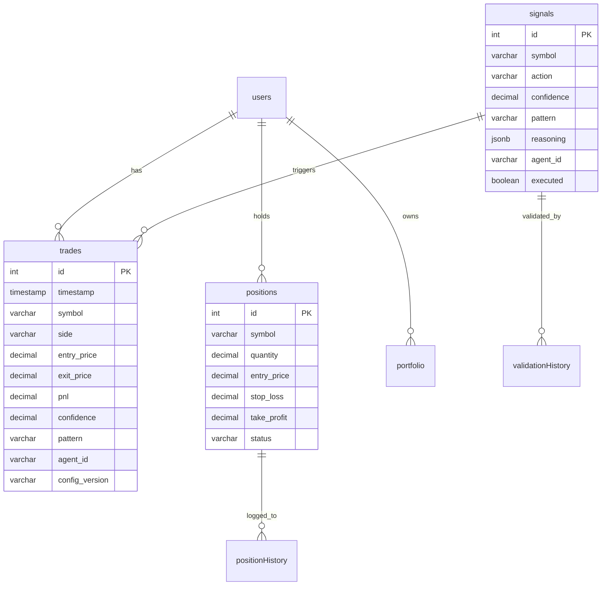

# 🏗️ Cryonix Agent Army — Fullständig Systemöversikt

## Sammanfattning

Cryonix är en **multi-agent autonom handelsplattform** som kör 12+ oberoende trading-agenter, varav varje agent har sitt eget fokusområde (krypto spot, US-aktier, Solana DEX, prediction markets, Polymarket, manipulationsdetektering, etc.). Systemet är byggt som en **monorepo** med `pnpm` workspaces, körs i **Docker** på en Azure VM, och styrs av en central konfigurationsfil (`cryonix.toml`).

---

## 1. Marknader & Tillgångsklasser

| Agent | Marknad | Börs/Broker | Handel |
|-------|---------|-------------|--------|
| **Cryonix Core** | Krypto Spot/Margin | Binance (CCXT) | Live |
| **Aktienix** | US-aktier | Alpaca (paper + live) | Paper → Live |
| **Solanix** | Solana DEX tokens | Helius RPC / Jupiter | Paper |
| **Copynix** | Solana copy-trading | Helius / Shyft / DexCheck | Paper |
| **Huntrix** | Krypto manipulation ride | Binance + Bybit + MEXC | Live |
| **Polynix** | Polymarket binary options | Polymarket API | Paper |
| **Psinix** | Krypto (Kuramoto phase sync) | Finnhub + Binance | Paper |
| **Apex** | Meta-confluence (alla agenter) | Binance | Live |
| **Vedic Trader** | Krypto (astrologi-experiment) | Paper trading | Paper |
| **Vedic Futures** | Krypto (Bayesian LONG+SHORT) | Paper trading | Paper |
| **Vedic BTD** | Krypto (Venus Rx buy-the-dip) | Paper trading | Paper |
| **Alphanix** | Multi-asset (krypto + aktier) | Binance + Alpaca | Paper |
| **Predator Hunter** | Krypto (front-running detect) | Binance | Paper |

---

## 2. Externa API:er

### Marknadsdata
| API | Vad det ger | Nyckel |
|-----|-------------|--------|
| **Binance** (CCXT) | OHLCV prisstaplar, orderbok, ticker, kontohantering, orderexekvering | `BINANCE_API_KEY` |
| **Alpaca** | US-aktier: priser, ordrar, positioner, marknadskalender | `ALPACA_API_KEY` |
| **CoinMarketCap** | Fear & Greed index, BTC dominance, marknadsdata, FDV, ranking | `CMC_API_KEY` |
| **Coinglass** | Futures data, open interest, funding rates, likvidationer | `COINGLASS_API_KEY` |
| **Finnhub** | Aktiefundamenta, nyheter, earnings | `FINNHUB_API_KEY` |
| **Helius** | Solana RPC, transaktionshistorik, token-metadata | `HELIUS_API_KEY` |
| **Shyft** | Solana wallet analytics, DeFi data | `SHYFT_API_KEY` |
| **DexCheck** | DEX wallet tracking, top traders | `DEXCHECK_API_KEY` |
| **Dune Analytics** | On-chain SQL queries | `DUNE_API_KEY` |
| **FRED** | Makroekonomisk data (räntor, CPI, arbetsmarknad) | `FRED_API_KEY` |
| **Polymarket** | Prediction market priser, event data | Nyckelfri (publik) |

### AI & Sentimentanalys
| API | Modell | Syfte |
|-----|--------|-------|
| **xAI (Grok)** | `grok-4-1-fast-reasoning` | Trade-validering (approve/reject med reasoning) |
| **xAI (Grok)** | `grok-3-mini` | X/Twitter sentimentanalys med live search |
| **Anthropic (Claude)** | `claude-opus-4-6` via CLI | Evolution Engine — autonom kodmutation |
| **Anthropic (Claude)** | Claude Code CLI | Brain-instanser (Aktienix, Alphanix, Huntrix) |

### Kommunikation
| API | Syfte |
|-----|-------|
| **Telegram Bot API** | Trade-alerts, performance-rapporter, interaktiv bot |
| **Telegram MTProto** (Telethon) | Signal-scraping från externa kanaler |
| **Discord Webhooks** | Signal-distribuering |

---

## 3. Datalagring

### 3.1 PostgreSQL (Persistent Data)

Databasen `cryonix` (Postgres 15 Alpine) använder **Drizzle ORM** med 20+ tabeller:



**Huvudtabeller:**

| Tabell | Vad den lagrar |
|--------|----------------|
| `trades` | Alla utförda trades (symbol, side, P&L, confidence, pattern, config_version) |
| `signals` | Genererade signaler från alla agenter (TA-data, metadata, om den exekverades) |
| `positions` | Öppna/stängda positioner med SL/TP |
| `position_history` | Fullständig historik med close_reason, holding_period, fees |
| `market_data` | OHLCV-data per timeframe (1m → 1d) |
| `portfolio` | Portföljvärde, cash-balanser |
| `validation_history` | AI-validering: source_votes, consensus, adjusted confidence, token usage |
| `risk_checks` | Riskbedömningar: Kelly-fraction, position sizing, godkänt/avvisat |
| `evolution_runs` | Varje Evolution Engine-körning: duration, performance, changes made |
| `config_changes` | TOML-ändringar med diff, källa (evolution/brain/human) |
| `calibration_history` | Pattern EV-snapshots (dagliga, per run_type) |
| `autopilot_actions` | AI Brain-åtgärder: action_type, target, old/new value, confidence |
| `backtest_results` | Backtestresultat: config, metrics, equity curve, pattern performance |
| `telegram_signals` | Parserade signaler från externa Telegram-kanaler |
| `telegram_channels` | Kanalkvalitet: win rate, total signals, active status |
| `watchlist_changes` | Dynamisk watchlist-rotation: added/removed symbols, Grok reasoning |
| `aktienix_positions` | Aktienix-specifika positioner (Alpaca broker) |
| `aktienix_trades` | Aktienix trades med broker order_id |
| `aktienix_signals` | Aktienix signaler med macro_boost och macro_blocked |
| `solanix_positions` | Solanix DEX-positioner med mint_address |
| `solanix_trades` | Solanix trades |
| `agent_actions` | Generisk agent-åtgärdslogg |
| `ml_models` | ML-modellmetadata (namn, version, accuracy) |
| `orchestrator_state` | Orchestrator-status |

### 3.2 Redis (Realtidsdata & Cache)

Redis 7 Alpine med AOF-persistens. Används för:

| Nyckelnamn | TTL | Vad |
|------------|-----|-----|
| `trades:pending` | — | Signalkö från engine → auto-trader |
| `positions:*` | — | Aktiva positioner per agent |
| `calibration:patterns` | 24h | Pattern EV-scores |
| `calibration:accuracy` | 48h | Self-calibration accuracy |
| `cmc:fear_greed` | 10min | Fear & Greed index |
| `cmc:global` | 10min | Global market cap, BTC dominance |
| `cmc:mcap:{SYMBOL}` | 10min | Per-symbol market cap + FDV |
| `sentiment:{SYMBOL}` | 1h | Sentiment score per coin |
| `sentiment:alert:{SYMBOL}` | 30min | Hack/exploit alert flags |
| `x-sentiment:latest` | 15min | Senaste X sentiment batch |
| `telegram:signal:{SYMBOL}` | 30min | Externa Telegram-signaler |
| `evolution:directives` | — | AI Brain → Evolution Engine kommunikation |
| `instance:lock` | 60s | Förhindrar dubbeltrade |
| `position:lock:{ID}` | 30s | Per-position atomär lås |
| `cvd:{SYMBOL}` | — | Cumulative Volume Delta |
| `orakel:forecast:*` | — | ML-prognoser |
| `regime:current` | 1h | Marknadsregim (trending/volatile/ranging) |

---

## 4. Systemarkitektur — Processer & Motorer

### 4.1 Python Engine (`packages/engine`)

**Kärnan i signalgenerering.** Kör som Docker-container med FastAPI (port 8000).

```
packages/engine/src/
├── main.py            — FastAPI entrypoint + event loop
├── tanks/             — Oberoende scanner-moduler
│   ├── market_scout.py      — 10s loop: OHLCV → 8 patterns → Redis
│   ├── news_scout.py        — 15min: RSS sentiment scoring
│   ├── cmc_scout.py         — 10min: Fear/Greed, BTC dom, market caps
│   ├── coinglass_scout.py   — Funding rates, open interest
│   ├── liquidation_scout.py — Likvidationsdata
│   ├── gainer_scanner.py    — Top movers (1h % change)
│   └── vedic_scout.py       — Astrologi-data (planets, transits)
├── guilds/            — Analysdrivare
│   └── quant_guild.py       — 8 mönsterdetektorer (RSI, BB, MACD, EMA, Vol Spike, Dip Buy, Deep Value, Momentum)
├── core/              — Risk-gate, config-loader
└── models/            — Datamodeller
```

**Pattern Detection Pipeline:**
```
Binance OHLCV (15m candles, 100 bars)
  → RSI_OVERSOLD check (RSI < 35)
  → BOLLINGER_SQUEEZE (width < 30th pctl)
  → MACD_BULLISH_CROSS
  → EMA_CROSS_UP (9/21 EMA)
  → VOLUME_SPIKE_UP (vol > 1.8× avg)
  → DIP_BUY (3%+ drawdown)
  → DEEP_VALUE_CRASH (8%+ drawdown)
  → MOMENTUM_GAINER
  → RiskGate (confidence ≥ 55%)
  → Redis trades:pending
```

### 4.2 Orakel Intelligence (`packages/intelligence`)

ML-prognos och regimklassificering. Kör som separat Docker-container (port 8001).

```
packages/intelligence/src/
├── main.py      — FastAPI server
├── orakel/      — Forecast engine (LSTM/XGBoost)
├── guilds/      — Feature engineering
├── models/      — Serialized models (Docker volume: orakel-models)
└── api/         — REST endpoints
```

### 4.3 Auto-Trader (`scripts/services/auto-trader.mjs`)

Execution loop (Node.js) som pollar varje 60s:

```
1. Monitor open positions → SL/TP/trailing/stagnation
2. Read trades:pending from Redis
3. Capital allocator check (regime-based budgets)
4. GainerScanner boost (+10%)
5. Telegram signal boost (+5-12%, Phase 1: log only)
6. CMC Fear & Greed adjustment
7. CMC BTC dominance penalty
8. Filters: spot-only, max positions, daily limit, CMC rank,
   FDV/MC ratio, EV model, X sentiment, orderbook spread
9. Grok AI validation (fail-closed)
10. Execute BUY on Binance via CCXT
11. Place native STOP_LOSS_LIMIT
12. Tag trade with config_version hash
```

### 4.4 Signal Worker (`scripts/services/signal-worker.mjs`)

Push-baserad execution via **Redis Pub/Sub** — komplement till pollingbaserad auto-trader för snabbare signalhantering.

### 4.5 CVD Monitor (`scripts/services/cvd-monitor.mjs`)

Bevakar **Cumulative Volume Delta** — order flow-analys via Binance WebSocket för att detektera köp/säljtryck i realtid.

### 4.6 Self-Improvement Systems

#### Evolution Engine (`scripts/evolution/copilot-evolution.mjs`)
- **Schema:** Var 2:a timme
- Analyserar 48h performance → identifierar problem
- Claude Code CLI (`claude-opus-4-6`) genererar mutationer
- Ändrar `cryonix.toml` + Python/TS-kod
- Max 100-raders diff-guard, backup + rollback
- Verification suite → git commit

#### AI Brain (`scripts/strategy-lab/ai_brain.py`)
- **Schema:** Var 6:e timme + akut trigger vid 3+ förluster
- Grok 3 Mini Fast analyserar trades, calibration, pipeline
- Max 4 åtgärder/körning, confidence ≥ 0.7 för auto-apply
- Skickar `evolution:directives` till Redis

#### Pattern Calibrator (`scripts/strategy-lab/calibrate.py`)
- **Schema:** Var 6:e timme
- `EV = (winRate × avgWin) - ((1-winRate) × |avgLoss|)`
- Skriver till Redis + Postgres snapshot

#### Self-Calibrator (`scripts/strategy-lab/self_calibrate.py`)
- Jämför signalprediktioner mot faktiska prisutfall
- Per-pattern hit rate, filter-effektivitet

---

## 5. Agent-Arkitektur

Alla agenter ärver från `base-agent.ts`:

```
packages/agents/src/
├── base-agent.ts       — Gemensam agent-klass
├── aktienix/           — US-aktiehandel (Alpaca)
├── alphanix/           — Multi-asset AI army
├── apex/               — Meta-confluence (konsumerar alla agenters signaler)
├── copynix/            — Solana copy-trading
├── huntrix/            — Manipulation detection & ride
├── polynix/            — Polymarket binary options
├── psinix/             — Kuramoto phase sync
├── solanix/            — Solana DEX trading
├── predatorhunter/     — Front-running detection
├── market-scout/       — TA-analys
├── signal-validator/   — AI-validering
├── risk-manager/       — Position sizing, Kelly
├── executor/           — Order execution
├── orchestrator/       — Agent-koordinering
├── analytics/          — Performance tracking
└── shared/             — Gemensamma typer & utilities
```

### Agent-specifika Brain-instanser (Claude Code CLI)
| Brain | Agent | Kör var |
|-------|-------|---------|
| `aktienix-brain` | Aktienix | Cron (portföljanalys, config-tuning) |
| `alphanix-brain` | Alphanix | Cron (multi-asset optimering) |
| `huntrix-brain` | Huntrix | Cron (manipulationsanalys) |

Brains har **Docker socket proxy-access** (restrikterad — bara container restart) via `tecnativa/docker-socket-proxy`.

---

## 6. Web-App & API:er (`apps/web`)

**Next.js** dashboard (port 3000) med **70+ API-routes**:

### Kärn-API:er
| Route | Vad |
|-------|-----|
| `/api/auto-trade` | Huvudhandels-endpoint (signal → validation → execution) |
| `/api/health` | Systemhälsa (Redis, Postgres, Engine, MarketScout) |
| `/api/positions` | Aktiva positioner |
| `/api/trades` | Trade-historik |
| `/api/signals` | Signalhistorik |
| `/api/portfolio` | Portföljöversikt |
| `/api/calibration` | EV-kalibrering |
| `/api/evolution` | Evolution-körningar |
| `/api/autopilot` | AI Brain-åtgärder |
| `/api/market` | Marknadsdata |
| `/api/metrics` | Performance metrics + rejections + mutations |
| `/api/overview` | Dashboard-sammanfattning |
| `/api/chart-data` | Equity curve data |
| `/api/costs` | API-kostnadsspårning |
| `/api/backtest` | Backtest-körning |

### Agent-specifika API:er
| Prefix | Agent |
|--------|-------|
| `/api/aktienix/*` | Portfolio, positions, signals, status, trades, sentiment |
| `/api/alphanix/*` | Backtest, positions, signals, status, trades |
| `/api/copynix/*` | Portfolio, positions, status, trades, wallets |
| `/api/polynix/*` | Portfolio, positions, status, trades |
| `/api/solanix/*` | Status, trades |
| `/api/huntrix/*` | Status |
| `/api/psinix/*` | Status, trades |
| `/api/apex/*` | Status |
| `/api/vedic/*` | Results, status |
| `/api/polymarket/*` | Spreads |

### Infrastruktur
| Route | Vad |
|-------|-----|
| `/api/orchestrator/start\|stop\|status` | Agent-orkestrator |
| `/api/agents` | Lista alla registrerade agenter |
| `/api/chat` | AI-chat (Grok) |
| `/api/analyze` | On-demand analys |

---

## 7. Infrastruktur

### Docker Compose (Produktion)

**25+ containers** i `docker-compose.prod.yml`:

```mermaid
graph TB
    subgraph Infrastruktur
        PG[Postgres 15]
        RD[Redis 7]
        CD[Caddy Reverse Proxy]
        DP[Docker Socket Proxy]
    end

    subgraph Core Trading
        EN[Engine - Python]
        WB[Web - Next.js]
        AT[Auto-Trader]
        SW[Signal Worker]
        CV[CVD Monitor]
        WS[WS Server]
    end

    subgraph Trading Agents
        AK[Aktienix]
        AL[Alphanix]
        AP[Apex]
        CO[Copynix]
        HU[Huntrix]
        PO[Polynix]
        PS[Psinix]
        SO[Solanix]
        VT[Vedic Trader]
        VF[Vedic Futures]
        VB[Vedic BTD]
    end

    subgraph Intelligence
        OR[Orakel ML]
        HS[Headline Scanner]
        PM[Polymarket Scanner]
        TB[Telegram Bot]
        TS[Telegram Scraper]
    end

    subgraph Brains - Claude CLI
        AB[Aktienix Brain]
        ALB[Alphanix Brain]
        HB[Huntrix Brain]
    end

    EN --> RD
    EN --> PG
    WB --> RD
    WB --> PG
    AT --> WB
    SW --> RD
    CV --> RD
    WS --> RD
    OR --> RD

    AK --> RD & PG
    AL --> RD & PG
    AP --> RD & PG
    HU --> RD & PG
    SO --> RD & PG

    AB --> DP
    ALB --> DP
    HB --> DP
```



### Portar
| Port | Service |
|------|---------|
| `3000` | Next.js Web App |
| `3004` | WebSocket Server |
| `5432` | Postgres (localhost only) |
| `6379` | Redis (localhost only) |
| `80` | Caddy (HTTP) |
| `8000` | Python Engine (intern) |
| `8001` | Orakel ML (intern) |

### Cron-schema (sammanfattning)

| System | Intervall |
|--------|-----------|
| MarketScout | 10s loop |
| Auto-Trader | 60s loop |
| CMCScout | 10min loop |
| NewsScout | 15min loop |
| X Sentiment | */15 min |
| Calibrator | */6h |
| AI Brain | */6h + akut trigger |
| Evolution Engine | */2h |
| Morning Report | 06:00 UTC |
| Health Monitor | */5min |
| Auto-Deploy | */1min |
| Postgres Backup | 03:00 UTC |

---

## 8. Konfigurationsstruktur

**Single source of truth** per agent:

| Fil | Agent | Storlek |
|-----|-------|---------|
| `cryonix.toml` | Core (crypto spot/margin) | 66KB, 1238 rader |
| `aktienix.toml` | Aktienix (US-aktier) | 20KB |
| `alphanix.toml` | Alphanix (multi-asset) | 3.6KB |
| `copynix.toml` | Copynix (Solana copy) | 7.4KB |
| `huntrix.toml` | Huntrix (manipulation) | 2.8KB |
| `polynix.toml` | Polynix (Polymarket) | 1.5KB |
| `psinix.toml` | Psinix (phase sync) | 2.9KB |
| `solanix.toml` | Solanix (DEX) | 1.4KB |
| `apex.toml` | Apex (meta-confluence) | 2.3KB |
| `predatorhunter.toml` | Predator Hunter | 5.5KB |

TOML-filerna monteras som **read-only Docker volumes** (`./agent.toml:/app/agent.toml:ro`), utom för Brain-containers som har read-write access för autonom mutation.

---

## 9. AI-modeller i Systemet

| Syfte | Modell | Provider | Var |
|-------|--------|----------|----|
| Trade-validering | `grok-4-1-fast-reasoning` | xAI | auto-trade route |
| X Sentiment | `grok-3-mini` | xAI | x_sentiment.py |
| AI Brain | `grok-3-mini-fast` | xAI | ai_brain.py |
| Headline Scanner | Grok (live X search) | xAI | headline-scanner.ts |
| Evolution | `claude-opus-4-6` | Anthropic CLI | copilot-evolution.mjs |
| Agent Brains | Claude Code CLI | Anthropic | aktienix/alphanix/huntrix-brain |
| Orakel Forecast | LSTM/XGBoost (lokala) | Self-hosted | intelligence package |

---

## 10. Dataflöde — Komplett Pipeline

```
┌──────────────── DATA INSAMLING ──────────────────┐
│ Binance OHLCV → MarketScout (10s)                │
│ CoinMarketCap  → CMCScout (10min)                │
│ RSS Feeds      → NewsScout (15min)               │
│ X/Twitter      → X Sentiment (15min, Grok)       │
│ Telegram       → Scraper (realtid, Telethon)     │
│ Polymarket     → Scanner (5min)                  │
│ Coinglass      → Liquidation/OI/Funding          │
│ Binance WS     → CVD Monitor (realtid)           │
│ Orakel         → ML Forecast (regelbundet)       │
└──────────────────────────────────────────────────┘
                    ↓
┌──────────────── SIGNALGENERERING ────────────────┐
│ QuantGuild: 8 pattern detectors                  │
│ Consensus Gate: multi-pattern confirmation       │
│ Smart Dip Hunter: value pattern filter           │
│ RiskGate: min confidence 55%                     │
│                  → Redis trades:pending          │
└──────────────────────────────────────────────────┘
                    ↓
┌──────────────── FILTRERING & VALIDERING ─────────┐
│ EV Model: reject negative-EV patterns            │
│ CMC Filters: rank ≤500, FDV/MC <4x              │
│ Sentiment: reject on hack/exploit alerts         │
│ GainerScanner boost (+10%)                       │
│ Telegram convergence boost                       │
│ Capital Allocator (regime-based)                 │
│ Grok AI Validation (fail-closed)                 │
│ Confidence blend: 60% TA + 40% AI               │
└──────────────────────────────────────────────────┘
                    ↓
┌──────────────── EXECUTION ───────────────────────┐
│ Binance: LIMIT BUY + STOP_LOSS_LIMIT             │
│ ATR-based SL/TP placement                         │
│ Config version hash tagging                       │
└──────────────────────────────────────────────────┘
                    ↓
┌──────────────── POSITION MANAGEMENT ─────────────┐
│ Trailing stop (3%, activation at 1.5%)            │
│ Stagnation exit (72h timeout)                     │
│ Smart rotation (replace weak positions)           │
│ Native SL monitoring                              │
│ Reconciliation (10min, Binance vs Redis)          │
└──────────────────────────────────────────────────┘
                    ↓
┌──────────────── SELF-IMPROVEMENT ────────────────┐
│ Calibrator → pattern EV scores (6h)              │
│ Self-Calibrator → prediction accuracy (6h)       │
│ AI Brain → parameter tuning (6h)                 │
│ Evolution Engine → code mutation (2h)            │
│ Morning Report → performance review (daily)      │
└──────────────────────────────────────────────────┘
```
